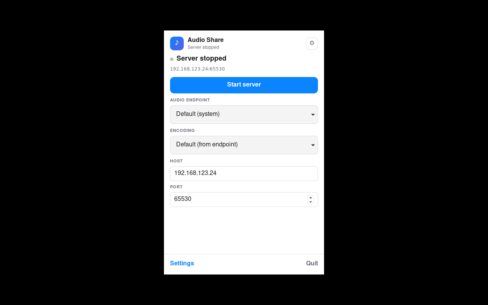

# Audio Share

<p align="center">
    
</p>

[](https://github.com/mkckr0/audio-share/releases/latest)
[](https://f-droid.org/packages/io.github.mkckr0.audio_share_app)
[](https://github.com/mkckr0/audio-share/blob/main/LICENSE)

Audio Share shares a computer's audio with an Android phone over the network,
so the phone becomes a speaker for the computer.

Version 0.4.0 replaces the Server with a Rust implementation: a shared
`audio-share-core` crate, a Tauri v2 Server GUI for Windows and Linux, and the
headless `as-cmd` CLI. The Wire Protocol is frozen at upstream v0.3.4; the
released **Android Client remains v0.3.4** and works without an update.

<p>


</p>

## Download

Release artifacts (each with a `sha256sum`-format `.sha256` sidecar):

| Platform | Artifact | Notes |
|---|---|---|
| Windows | `AudioShareServer.exe` | Portable Server GUI. Windows 10+ x86_64; requires the Microsoft Edge WebView2 Runtime (Windows 11 includes it). |
| Windows | `audio-share-server-cmd-windows.zip` | Headless `as-cmd.exe` inside a top-level `audio-share-server-cmd/` directory. |
| Linux | `AudioShareServer_<version>_amd64.deb` | Server GUI for Ubuntu 24.04+; installs `/usr/bin/AudioShareServer`. |
| Linux | `AudioShareServer_<version>_amd64.AppImage` | Self-contained Server GUI image; requires FUSE 2 to run directly. |
| Linux | `audio-share-server-cmd-linux.tar.gz` | Headless `as-cmd` inside a top-level `audio-share-server-cmd/` directory. |
| Android | v0.3.4 APK (unchanged) | No new APK is built or attached for 0.4.0. Use the v0.3.4 release or F-Droid. |

Linux packages depend on WebKitGTK 4.1 (`libwebkit2gtk-4.1-0`), GTK 3, the
StatusNotifier appindicator (`libayatana-appindicator3-1`), and PipeWire
(`libpipewire-0.3-0`). The deb declares these dependencies. A running PipeWire
session with a session manager (WirePlumber) is required for audio capture; the
desktop session must provide it.

## Server GUI

1. Start `AudioShareServer` (`AudioShareServer.exe` on Windows).
2. Check the Host and Port (default port `65530`). Host defaults to the first
   private IPv4 address. Make sure the phone can reach it.
3. Pick an audio Endpoint and an Encoding, then click **Start Server**.
4. In the Android Client, enter the same host and port and press play.

The window is tray-first: Show, Start/Stop, and Exit are available from the
tray menu. Settings include autostart, launch behavior, close behavior,
language (en-US / zh-CN), update checks, and (on Windows) Firewall Repair and
the system Sound Panel. Linux replaces the Windows-only maintenance actions
with documentation links; the tray menu is right-click only because Tauri does
not deliver left-click events on Linux.

## `as-cmd`

`as-cmd` is the headless Server, sharing the same capture and protocol core as
the GUI. Run it from the unpacked CLI archive:

```bash
as-cmd -b
```

A bare `-b` binds the default private address on port `65530` and selects the
default endpoint. Useful flags:

| Flag | Meaning |
|---|---|
| `-h`, `--help` | Print help, exit 0. |
| `-v`, `--version` | Print the version, exit 0. |
| `-l`, `--list-endpoint` | List capture endpoints and mark the default. |
| `-b`, `--bind [host][:port]` | Start the server. Both `--bind=host:port` and `-b host:port` are accepted; default port `65530`. |
| `-e`, `--endpoint <id>` | Endpoint id; `default` (the default) selects the backend default. |
| `--encoding <name>` | `default`, `f32`, `s8`, `s16`, `s24`, `s32`; `default` selects the endpoint format. |
| `--channels <n>` | Capture channels; `0` (the default) uses the endpoint value. |
| `--sample-rate <hz>` | Capture sample rate; `0` (the default) uses the endpoint value. |
| `--list-encoding` | List the supported encodings, exit 0. |
| `-V`, `--verbose` | Enable trace-level logging. |

Examples:

```bash
as-cmd -b
as-cmd --bind=192.168.1.20
as-cmd --bind=192.168.1.20 --encoding=f32 --channels=2 --sample-rate=48000
as-cmd -b 192.168.1.20:65080 -e 38 --encoding=s16
```

Ctrl-C stops capture and closes the TCP/UDP server gracefully. Errors print to
stderr with a non-zero exit code. See
[`docs/server-rewrite/as-cmd.md`](docs/server-rewrite/as-cmd.md) for the full
flag/dispatch/exit-code contract and intentional differences from v0.3.4.

## Configuration and logs

The Server GUI reads and writes `config.ini` in this order:

1. `AUDIO_SHARE_CONFIG` (path of the config file), when set.
2. `config.ini` next to the executable, when that directory is writable
   (portable Windows exe and development builds preserve v0.3.4 behavior).
3. `$XDG_CONFIG_HOME/audio-share-server/config.ini` (default
   `~/.config/audio-share-server/config.ini`) for read-only package installs
   and AppImages.

`server.log` lives in the same directory as the resolved `config.ini`. The GUI
and `as-cmd` truncate it on each server launch; help, version, and endpoint
listing never touch it. A v0.3.4 executable-directory `config.ini` found during
the fallback is migrated without discarding its settings. Configuration writes
are atomic.

The v0.3.4 sections and keys are still read; `configVersion` is migrated to
the rewrite's value and a backup is kept when migration changes a file.

## Protocol compatibility

The v0.3.4 Wire Protocol is frozen for 0.4.0:

- TCP control commands are fixed 4-byte little-endian integers:
  `GET_FORMAT = 1`, `START_PLAY = 2`, `HEARTBEAT = 3`.
- `GET_FORMAT` replies with `cmd`, `u32 size`, and the protobuf `AudioFormat`;
  `START_PLAY` replies with `cmd` and a positive `i32` id.
- The server sends a heartbeat every 3 seconds and closes a playing session
  after 5 seconds without a client heartbeat (checked on the 3-second tick,
  so clients observe the close at about 6 seconds).
- UDP carries raw PCM in the negotiated format. Datagrams are at most
  `1492 - 20 - 8 = 1464` bytes, aligned down to the format's `block_align`.
- The client binds UDP by sending its play id as a 4-byte little-endian
  integer to the server's TCP/UDP port.

The rewrite starts capture before accepting clients, so `GET_FORMAT` always
returns the real capture format instead of the old empty-format race. Server
stop closes TCP/UDP sessions without a protocol "bye"; clients reconnect as
before. Full byte-level details, protobuf field numbers, and close semantics
are in [`docs/protocol.md`](docs/protocol.md).

## Build from source

Prerequisites:

- Rust stable 1.90+ (the GUI crate's MSRV; the core itself is lower).
- Node.js 22+ and npm.
- Linux build dependencies on Ubuntu 24.04:

  ```bash
  sudo apt-get install -y build-essential curl wget file pkg-config libssl-dev \
    libwebkit2gtk-4.1-dev libgtk-3-dev libsoup-3.0-dev \
    libayatana-appindicator3-dev librsvg2-dev libxdo-dev patchelf \
    libpipewire-0.3-dev libspa-0.2-dev libclang-dev libfuse2t64
  ```

- Windows: the default Rust Windows toolchain with the Visual Studio 2022
  C++ build tools and Windows SDK, plus the WebView2 Runtime to run the GUI.

Build the CLI and GUI:

```bash
cargo build --release -p as-cmd
cd gui
npm ci
npm run build
npx tauri build --no-bundle          # Windows portable exe / Linux GUI binary
npx tauri build --bundles deb,appimage  # Linux deb + AppImage
```

Release packaging scripts (run from the repository root):

```bash
bash scripts/package-windows-artifacts.sh   # AudioShareServer.exe + CLI zip
bash scripts/package-linux-artifacts.sh     # deb + AppImage + CLI tar.gz
```

Quality gates and scripted protocol verification:

```bash
cargo fmt --check
cargo clippy --workspace --all-targets -- -D warnings
cargo test --workspace
(cd gui && npm ci && npm run check && npm run build)
cargo run -p protocol-harness -- replay \
  --fixture fixtures/protocol/v0.3.4/linux/f32-48k-stereo
```

More detail: [build and packaging](docs/server-rewrite/README.md),
[Wire Protocol](docs/protocol.md), and the
[deviation record](docs/adr/0003-server-rewrite-deviations.md).

## Known limitations

- No code signing, MSI/NSIS installer, or Tauri self-updater in this release.
- Windows requires WebView2. Linux requires WebKitGTK 4.1, GTK 3, the
  appindicator library, and a running PipeWire session.
- The GUI exposes Endpoint and Encoding only; channels and sample rate remain
  `as-cmd`-only, matching the v0.3.4 GUI.
- No log viewer; use `server.log`.
- Linux tray left-click is not delivered by Tauri; use the right-click menu.
- The Android Client is unchanged at v0.3.4. No Android source, version, or
  APK changes ship in 0.4.0.
- Real-device Android acceptance and long-run soak are release-gate checks
  tracked in [`docs/server-rewrite/`](docs/server-rewrite/README.md); scripted
  Wire Protocol replay is the automated compatibility check.
- The UDP header/reorder experiments on the `main` branch are not part of this
  release (see [ADR-0001](docs/adr/0001-server-rewrite-baseline.md)).

## License

This project is licensed under the [Apache-2.0 license](LICENSE).

```text
Copyright 2022-2024 mkckr0 <https://github.com/mkckr0>
```

### Used third-party libraries

- [Tokio](https://github.com/tokio-rs/tokio) — MIT
- [prost](https://github.com/tokio-rs/prost) — Apache-2.0
- [clap](https://github.com/clap-rs/clap) — MIT/Apache-2.0
- [tracing](https://github.com/tokio-rs/tracing) — MIT
- [Tauri](https://github.com/tauri-apps/tauri) — MIT/Apache-2.0
- [Svelte](https://github.com/sveltejs/svelte) — MIT
- [Vite](https://github.com/vitejs/vite) — MIT
- [PipeWire](https://gitlab.freedesktop.org/pipewire/pipewire) — MIT
- [wasapi](https://github.com/HEnquist/wasapi-rs) — MIT
- [windows-rs](https://github.com/microsoft/windows-rs) — MIT/Apache-2.0
- [Protocol Buffers](https://github.com/protocolbuffers/protobuf) — BSD-3-Clause
- [Ktor](https://github.com/ktorio/ktor) — Apache-2.0 (Android Client)
- [MaterialKolor](https://github.com/jordond/MaterialKolor) — MIT (Android Client)
