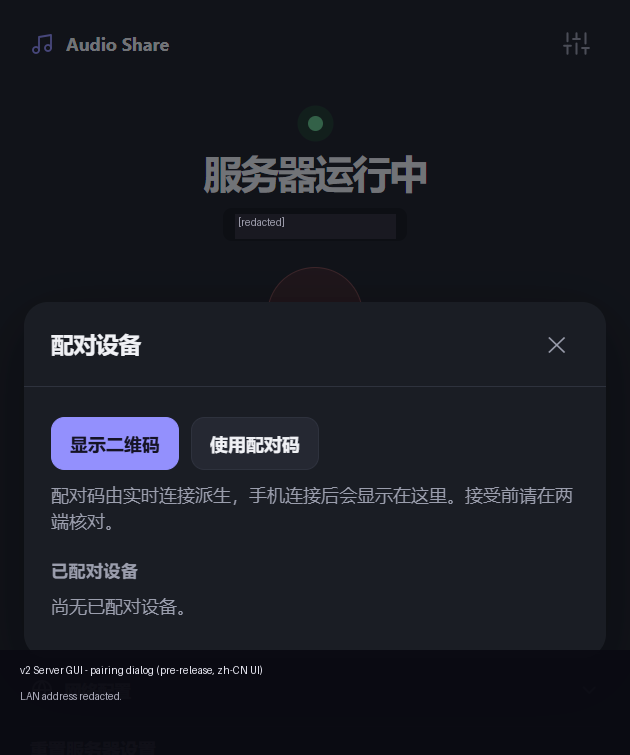
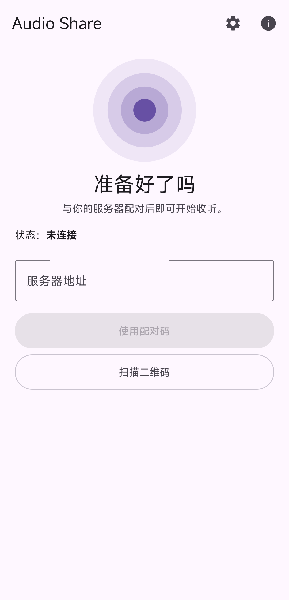
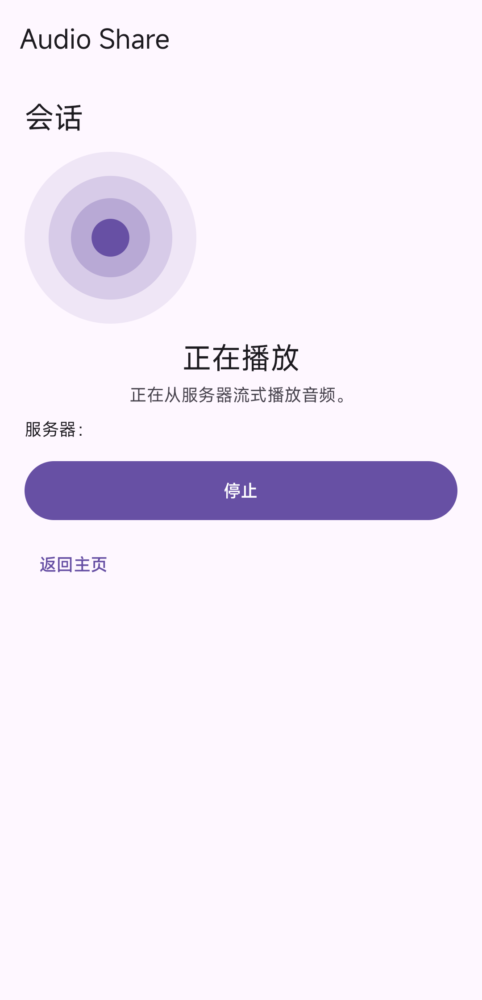

# Audio Share

<p align="center">
    
</p>

[](https://github.com/mkckr0/audio-share/releases/latest)
[](https://f-droid.org/packages/io.github.mkckr0.audio_share_app)
[](https://github.com/mkckr0/audio-share/blob/main/LICENSE)

Audio Share shares a computer's audio with an Android phone over the network,
so the phone becomes a speaker for the computer.

Version 0.6.0 ships the Rust Server with **two transports**: the frozen,
unencrypted v1 Wire Protocol (port 65530) for the existing v0.3.4 Android
client, and the encrypted, paired **Wire Protocol v2** (QUIC, UDP port 65531)
for the v2 Android client. The v2 client ships as two separately signed APKs,
one per ABI: `arm64-v8a` for phones and `x86_64` for emulators and x86 devices.
The v2 app (`dev.audioshare.v2`) installs alongside v1; it does not replace the
v1 app or its F-Droid listing.

<p>



</p>

<sub>Screenshots from pre-release testing; the UI is available in English and Chinese.</sub>

## Download

Release artifacts (each with a `sha256sum`-format `.sha256` sidecar):

| Platform | Artifact | Notes |
|---|---|---|
| Windows | `AudioShareServer.exe` | Portable Server GUI. Windows 10+ x86_64; requires the Microsoft Edge WebView2 Runtime (Windows 11 includes it). |
| Windows | `audio-share-server-cmd-windows.zip` | Headless `as-cmd.exe` inside a top-level `audio-share-server-cmd/` directory. |
| Linux | `AudioShareServer_<version>_amd64.deb` | Server GUI for Ubuntu 24.04+; installs `/usr/bin/AudioShareServer`. |
| Linux | `AudioShareServer_<version>_amd64.AppImage` | Self-contained Server GUI image; requires FUSE 2 to run directly. |
| Linux | `audio-share-server-cmd-linux.tar.gz` | Headless `as-cmd` inside a top-level `audio-share-server-cmd/` directory. |
| Android | `audio-share-client-v2-<version>-arm64-v8a.apk` | v2 Client for arm64 phones. |
| Android | `audio-share-client-v2-<version>-x86_64.apk` | v2 Client for x86_64 emulators and devices. |

The v1 APK is unchanged at v0.3.4. Use the [v0.3.4 release](https://github.com/mkckr0/audio-share/releases/tag/v0.3.4)
or F-Droid if you need it. Verify every download against its SHA-256 sidecar.
See the [release notes](docs/releases/v0.6.0.md) for compatibility, upgrade
notes, and validation limits.

Linux packages depend on WebKitGTK 4.1 (`libwebkit2gtk-4.1-0`), GTK 3, the
StatusNotifier appindicator (`libayatana-appindicator3-1`), and PipeWire
(`libpipewire-0.3-0`). The deb declares these dependencies. A running PipeWire
session with a session manager (WirePlumber) is required for audio capture; the
desktop session must provide it.

## Pair a v2 Client

The v2 transport is enabled by default on UDP port 65531; allow that port
through the firewall and make sure the phone can reach the Server host.

1. Start the Server GUI, pick an Endpoint and an Encoding, and click **Start Server**.
2. Open the **Pairing** dialog and choose a mode:
   - **QR (primary):** scan the displayed invitation with the v2 Android app.
     The QR pins the Server's public key; the invitation expires and is
     single-use.
   - **SAS (fallback, no camera):** if the app cannot scan, start SAS mode and
     compare the six-digit code shown on both ends. The SAS protects against
     an active first-connection MITM only when it is actually compared; an
     unchecked confirmation is trust-on-first-use. You can also verify the
     Server's SPKI fingerprint out of band (§7.2–7.4 of the pairing spec).
3. Approve the verified device on the Server. The phone then stores the pairing
   and connects automatically on later runs.
4. In the v2 app, select the paired Server and press play.

Pairing is one Client per Server in this release; concurrent phones and
multi-Client isolation are not supported. A failed v2 connection never falls
back to v1 or plaintext. If an older v2 beta left stale credentials (error
205), uninstall the old v2 app, install the current APK, and pair again;
uninstalling removes saved pairings. Full semantics are in the
[pairing specification](docs/wire-protocol-v2/pairing.md).

The v1 client needs no pairing: enter the Server's host and port 65530 in the
v0.3.4 app and press play. **Use v1 only on a trusted network** — it is
unencrypted and unauthenticated.

## Server GUI

1. Start `AudioShareServer` (`AudioShareServer.exe` on Windows).
2. Check the Host and Port (default port `65530`). Host defaults to the first
   address matching v0.3.4's private-network mask; the field also suggests the
   machine's local IPv4 addresses. Make sure the phone can reach it.
3. Pick an audio Endpoint and an Encoding, then click **Start Server**.
4. In the Android Client, enter the same host and port and press play (for v1),
   or pair once and press play (for v2).

The window is tray-first: Show, Start/Stop, and Exit are available from the
tray menu. Settings include the appearance theme (System / Light / Dark),
autostart, launch behavior, close behavior, language (en-US / zh-CN), update
checks, and (on Windows) Firewall Repair and the system Sound Panel. Linux
replaces the Windows-only maintenance actions with documentation links; the
tray menu is right-click only because Tauri does not deliver left-click events
on Linux.

## `as-cmd`

`as-cmd` is the headless Server, sharing the same capture and protocol core as
the GUI. Run it from the unpacked `as-cmd` archive:

```bash
as-cmd -b
```

A bare `-b` binds the default address (v0.3.4's private-network mask) on v1
port `65530` and selects the default endpoint. The v2 transport starts in
parallel on UDP `65531` unless `--v2-port=0` disables it. Useful flags:

| Flag | Meaning |
|---|---|
| `-h`, `--help` | Print help, exit 0. |
| `-v`, `--version` | Print the version, exit 0. |
| `-l`, `--list-endpoint` | List capture endpoints and mark the default. |
| `-b`, `--bind [host][:port]` | Start the server. Both `--bind=host:port` and `-b host:port` are accepted; default port `65530`. |
| `-e`, `--endpoint <id>` | Endpoint id; `default` (the default) selects the backend default. |
| `--encoding <name>` | `default`, `f32`, `s8`, `s16`, `s24`, `s32`; `default` selects the endpoint format. |
| `--channels <n>` | Capture channels; `0` (the default) uses the endpoint value. |
| `--sample-rate <hz>` | Capture sample rate; `0` (the default) uses the endpoint value. |
| `--list-encoding` | List the supported encodings, exit 0. |
| `--v2-port <port>` | v2 QUIC listen port; default `65531`; `0` disables v2. |
| `-V`, `--verbose` | Enable trace-level logging. |

Headless pairing and authorization use subcommands:

```bash
as-cmd pair [--sas] [--accept] [--addr host:port] [--timeout seconds]
as-cmd clients list
as-cmd clients revoke <client-id>
as-cmd identity reset [--yes]
```

`pair` prints a QR invitation (or opens only the SAS window with `--sas`) and
waits up to 600 seconds for a device by default (`--timeout`); `--accept`
approves the first verified device without a prompt. Invitation lifetime is
governed by the pairing specification, not by `--timeout`. `clients` lists or
revokes authorized Clients; `identity reset` generates a new Server identity
and invalidates all existing pairings.

Examples:

```bash
as-cmd -b
as-cmd --bind=192.168.1.20
as-cmd --bind=192.168.1.20 --encoding=f32 --channels=2 --sample-rate=48000
as-cmd -b 192.168.1.20:65080 -e 38 --encoding=s16
as-cmd pair --addr 192.168.1.20:65531
```

Ctrl-C stops capture and closes the TCP/UDP server gracefully. Errors print to
stderr with a non-zero exit code. See
[`docs/server-rewrite/as-cmd.md`](docs/server-rewrite/as-cmd.md) for the full
v1 flag/dispatch/exit-code contract, and
[`docs/wire-protocol-v2/pairing.md`](docs/wire-protocol-v2/pairing.md) §11.2 for
headless pairing details.

## Configuration and logs

The Server GUI reads and writes `config.ini` in this order:

1. `AUDIO_SHARE_CONFIG` (path of the config file), when set.
2. `config.ini` next to the executable, when that directory is writable
   (portable Windows exe and development builds preserve v0.3.4 behavior).
3. `$XDG_CONFIG_HOME/audio-share-server/config.ini` (default
   `~/.config/audio-share-server/config.ini`) for read-only package installs
   and AppImages.

`server.log` lives in the same directory as the resolved `config.ini`. The GUI
truncates it at application startup; `as-cmd` truncates it on each server
launch. Help, version, and endpoint listing never touch it. A v0.3.4
executable-directory `config.ini` found during the fallback is migrated without
discarding its settings. Configuration writes are atomic.

The v0.3.4 sections and keys are still read; `configVersion` is migrated to
the rewrite's value and a backup is kept when migration changes a file.

## Protocol compatibility

v1 is frozen at upstream v0.3.4:

- TCP control commands are fixed 4-byte little-endian integers:
  `GET_FORMAT = 1`, `START_PLAY = 2`, `HEARTBEAT = 3`.
- `GET_FORMAT` replies with `cmd`, `u32 size`, and the protobuf `AudioFormat`;
  `START_PLAY` replies with `cmd` and a positive `i32` id.
- The server sends a heartbeat every 3 seconds and closes a playing session
  after 5 seconds without a client heartbeat (checked on the 3-second tick,
  so clients observe the close at about 6 seconds).
- UDP carries raw PCM in the negotiated format. Datagrams are at most
  `1492 - 20 - 8 = 1464` bytes, aligned down to the format's `block_align`.
- The client binds UDP by sending its play id as a 4-byte little-endian
  integer to the server's TCP/UDP port.

v2 is a separate, encrypted transport on UDP 65531. It uses QUIC with
Ed25519 Server identities and per-Client credentials from pairing, a framed
control plane, and a media plane with a bounded jitter buffer, concealment,
and playback clock-drift correction. It is specified in the
[v2 specification](docs/wire-protocol-v2/spec.md),
[pairing specification](docs/wire-protocol-v2/pairing.md), and
[threat model](docs/wire-protocol-v2/threat-model.md). Byte-level v1 details,
protobuf field numbers, and close semantics are in
[`docs/protocol.md`](docs/protocol.md).

## Build from source

Prerequisites:

- Rust stable 1.90+ (workspace MSRV).
- Node.js 22+ and npm.
- Linux build dependencies on Ubuntu 24.04:

  ```bash
  sudo apt-get install -y build-essential curl wget file pkg-config libssl-dev \
    libwebkit2gtk-4.1-dev libgtk-3-dev libsoup-3.0-dev \
    libayatana-appindicator3-dev librsvg2-dev libxdo-dev patchelf \
    libpipewire-0.3-dev libspa-0.2-dev libclang-dev libfuse2t64
  ```

- Windows: the default Rust Windows toolchain with the Visual Studio 2022
  C++ build tools and Windows SDK, plus the WebView2 Runtime to run the GUI.
- Android v2: Android SDK and NDK 27.2 (see
  [`android-client-v2/README.md`](android-client-v2/README.md) for signing,
  per-ABI builds, and device-test builds).

Build `as-cmd` and the GUI:

```bash
cargo build --release -p as-cmd
cd gui
npm ci
npm run build
npx tauri build --no-bundle          # Windows portable exe / Linux GUI binary
npx tauri build --bundles deb,appimage  # Linux deb + AppImage
```

Release packaging scripts (run from the repository root):

```bash
bash scripts/package-windows-artifacts.sh   # AudioShareServer.exe + as-cmd zip
bash scripts/package-linux-artifacts.sh     # deb + AppImage + as-cmd tar.gz
```

Quality gates and scripted protocol verification:

```bash
cargo fmt --check
cargo clippy --workspace --all-targets -- -D warnings
cargo test --workspace
(cd gui && npm ci && npm run check && npm run build)
cargo run -p protocol-harness -- replay \
  --fixture fixtures/protocol/v0.3.4/linux/f32-48k-stereo
```

More detail: [build and packaging](docs/server-rewrite/README.md),
[v1 Wire Protocol](docs/protocol.md), and the
[deviation record](docs/adr/0003-server-rewrite-deviations.md).

## Known limitations

- This release supports one v2 Client per Server; concurrent phones and
  multi-Client isolation are outside its scope.
- The acoustic latency baseline and the 60-minute single-client run were
  waived; no p95/p99 audible-latency target is claimed. Real-network
  impairment testing, device clock-drift injection, and listening A/B for the
  drift-control change were not run; the impairment matrix was exercised on
  host only. See the [release notes](docs/releases/v0.6.0.md).
- No code signing for Windows binaries, MSI/NSIS installer, or Tauri
  self-updater in this release. The v2 APKs are signed with the project's
  beta key.
- Windows requires WebView2. Linux requires WebKitGTK 4.1, GTK 3, the
  appindicator library, and a running PipeWire session.
- The GUI exposes Endpoint and Encoding only; channels and sample rate remain
  `as-cmd`-only, matching the v0.3.4 GUI.
- No log viewer; use `server.log`.
- Capture does not restart automatically after the target Endpoint disappears,
  a sink/Endpoint change, or sleep/resume. The Server stays Running with the old
  format and sends no PCM until the operator presses Stop then Start (or
  restarts `as-cmd`). A capture supervisor is follow-up work.
- Linux tray left-click is not delivered by Tauri; use the right-click menu.
- The v1 Android Client is unchanged at v0.3.4. A failed v2 connection never
  silently switches to v1 or plaintext. Full migration and rollback acceptance
  are outside this release.

## License

This project is licensed under the [Apache-2.0 license](LICENSE).

```text
Copyright 2022-2024 mkckr0 <https://github.com/mkckr0>
```

### Used third-party libraries

- [Tokio](https://github.com/tokio-rs/tokio) — MIT
- [prost](https://github.com/tokio-rs/prost) — Apache-2.0
- [clap](https://github.com/clap-rs/clap) — MIT/Apache-2.0
- [tracing](https://github.com/tokio-rs/tracing) — MIT
- [Tauri](https://github.com/tauri-apps/tauri) — MIT/Apache-2.0
- [Svelte](https://github.com/sveltejs/svelte) — MIT
- [Vite](https://github.com/vitejs/vite) — MIT
- [PipeWire](https://gitlab.freedesktop.org/pipewire/pipewire) — MIT
- [wasapi](https://github.com/HEnquist/wasapi-rs) — MIT
- [windows-rs](https://github.com/microsoft/windows-rs) — MIT/Apache-2.0
- [Protocol Buffers](https://github.com/protocolbuffers/protobuf) — BSD-3-Clause
- [quinn](https://github.com/quinn-rs/quinn) — MIT/Apache-2.0 (Wire Protocol v2)
- [rustls](https://github.com/rustls/rustls) — Apache-2.0/MIT/ISC (Wire Protocol v2)
- [ring](https://github.com/briansmith/ring) — Apache-2.0/ISC (Wire Protocol v2)
- [rcgen](https://github.com/rustls/rcgen) — Apache-2.0/MIT/ISC (Wire Protocol v2)
- [Ktor](https://github.com/ktorio/ktor) — Apache-2.0 (Android Client)
- [MaterialKolor](https://github.com/jordond/MaterialKolor) — MIT (Android Client)
