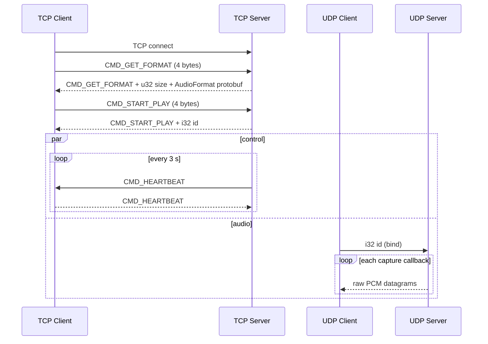

# Wire Protocol (frozen at v0.3.4)

Status: **frozen**. Audio Share Server 0.4.0 and the released Android Client
v0.3.4 speak exactly this protocol. No field, command value, timing, framing,
or UDP rule may change in 0.4.0. The Rust implementation is the reference for
0.4.0; its golden fixtures live under
[`fixtures/protocol/v0.3.4/`](../fixtures/protocol/v0.3.4/README.md) and are
replayed by `tools/protocol-harness`.



## 1. Transport and byte order

- One TCP control connection and one UDP socket use the **same server host and
  port** (default `65530`).
- Every control integer is **little-endian**. Nothing depends on the host byte
  order.
- TCP has **no length prefix around commands**. Each request command is
  exactly 4 bytes. Only two server replies carry additional data:
  `GET_FORMAT` (`u32 size` + protobuf) and `START_PLAY` (`i32 id`).
- Accepted TCP sockets use `TCP_NODELAY`.
- The server's TCP listener uses `SO_REUSEADDR` and a listen backlog of 1024.
- PCM samples are little-endian in the encoding given by `AudioFormat`
  (`ENCODING_PCM_FLOAT` is IEEE-754 binary32 little-endian).

## 2. Commands

| Name | Value (`u32`) | Direction | Payload |
|---|---:|---|---|
| `CMD_NONE` | 0 | never sent | Receiving 0 closes the connection. |
| `CMD_GET_FORMAT` | 1 | client → server | none (4 bytes total). |
| `CMD_GET_FORMAT` reply | 1 | server → client | `u32 size` + `size` bytes of `AudioFormat` protobuf. |
| `CMD_START_PLAY` | 2 | client → server | none (4 bytes total). |
| `CMD_START_PLAY` reply | 2 | server → client | `i32 id` (4 bytes). |
| `CMD_HEARTBEAT` | 3 | both directions | none (4 bytes total). |

Dispatch rules:

- `GET_FORMAT` may be sent more than once on the same connection.
- `START_PLAY` twice on the same connection closes the connection without a
  second reply.
- An unknown command or 0 closes the connection without a response.
- Commands may be fragmented across TCP reads or pipelined in one write; the
  receiver treats the stream as consecutive 4-byte commands.
- A connection that only sends `GET_FORMAT` is never timed out.

## 3. `AudioFormat` protobuf

The schema is [`protos/client.proto`](../protos/client.proto) (the Android app
compiles the same file):

```proto
syntax = "proto3";
package io.github.mkckr0.audio_share_app.pb;

message AudioFormat {
  enum Encoding {
    ENCODING_INVALID = 0;
    ENCODING_PCM_FLOAT = 1;   // PCM encodings are all little-endian
    ENCODING_PCM_8BIT = 2;
    ENCODING_PCM_16BIT = 3;
    ENCODING_PCM_24BIT = 4;
    ENCODING_PCM_32BIT = 5;
  }
  Encoding encoding = 1;
  int32 channels = 2;
  int32 sample_rate = 3;
}
```

- Field numbers, wire types, and enum values are frozen.
- `encoding` is a varint field; `channels` and `sample_rate` are `int32`
  varints.
- proto3 omits zero-valued scalar fields, so an all-zero `AudioFormat`
  serializes to **0 bytes**. The Android Client then sees
  `INVALID`/`0`/`0` and cannot create a usable `AudioTrack`.
- A normal default Linux capture (F32, stereo, 48 kHz) serializes as
  `08 01 10 02 18 80 f7 02` (8 bytes), and the full reply is
  `01 00 00 00  08 00 00 00  08 01 10 02 18 80 f7 02`.

### 0.4.0 startup format guarantee

v0.3.4 started its listener before PipeWire/WASAPI negotiation completed, so a
client that connected early could receive `size = 0`. The 0.4.0 Server starts
capture and waits for the actual format **before** it binds TCP/UDP and accepts
clients. If capture cannot start, `as-cmd`/the GUI reports a readable error and
does not start listening. `GET_FORMAT` therefore always returns a complete,
consistent, non-empty `AudioFormat` for a running server; the format is
immutable for the lifetime of that server session. This is protocol-compatible:
the frozen client accepts any valid `AudioFormat`, and it removes an old race
that made the Android Client build an invalid audio track.

## 4. `START_PLAY` ids

- The server assigns `id = ++g_id`, a **process-wide** monotonically increasing
  `i32` starting at 1. Ids are not reset between clients, sessions, or Server
  instances: stopping and starting the Server in the same GUI process continues
  the sequence, exactly like v0.3.4's function-static counter. Only a new
  process starts again at 1.
- The reply is exactly `cmd (u32) + id (i32)`, with no size field.
- The Android Client requires `id > 0`.
- `id` identifies both the playing peer and the UDP destination binding. A
  second `START_PLAY` on the same TCP connection is an error and closes the
  connection.

## 5. Heartbeat and timeout

- A playing session (after a successful `START_PLAY`) gets a server heartbeat
  every **3 seconds**.
- `HEARTBEAT` is a bare 4-byte command in both directions.
- The server refreshes the session's last-tick on any client `HEARTBEAT`.
- The timeout threshold is **5 seconds**. It is evaluated on the 3-second
  timer tick, immediately before the next heartbeat is sent. A client that
  never replies is therefore closed at the **second** tick, about **6 seconds**
  after `START_PLAY` (observed at 6.0 s; heartbeats would be at 3.0, 6.0, 9.0,
  ...).
- Only sessions that completed `START_PLAY` are timed out. A `HEARTBEAT`
  received before `START_PLAY` is ignored.
- The Android Client mirrors this: it checks every 3 seconds and treats more
  than 5 seconds without a server heartbeat as a timeout, so it also detects
  failure at roughly 6 seconds.

## 6. UDP bind and audio datagrams

### Binding

- The Android Client binds the local IP of its TCP socket to an ephemeral UDP
  port and sends a 4-byte little-endian `i32` play id to the server's host and
  UDP port.
- The server looks up the id in its playing-session table:
  - unknown id: log and ignore, no response, no crash;
  - known id: bind/overwrite that session's UDP destination.
- The **last bind for an id wins**; later datagrams go to the new address.
- A datagram shorter than 4 bytes is interpreted with the missing bytes as
  zero; longer datagrams are truncated to the first 4 bytes.
- Until a client binds, it receives no audio even though it has completed
  `START_PLAY`.

### Datagram shape

- Each datagram is **raw PCM only**: no header, sequence number, timestamp, or
  reorder buffer. There is no retransmission and no pacing.
- One capture callback is split into consecutive chunks. The maximum payload
  is:

  ```text
  MTU 1492 bytes - IP header 20 bytes - UDP header 8 bytes = 1464 bytes
  max_seg_size -= max_seg_size % block_align
  ```

  where `block_align = bytes_per_sample * channels`. For F32 stereo,
  `block_align = 8`, so each datagram carries at most 1464 bytes (183 frames)
  and the final chunk is the remainder (for example 8192 bytes split as
  5 × 1464 + 872).
- Every playing peer receives the same datagram sequence for a capture
  callback; multi-client tails are byte-identical.
- If `block_align` is 0 or greater than 1464, the 0.4.0 core emits no segments
  and reports the condition once instead of dividing by zero, hanging, or
  sending oversized datagrams (v0.3.4 had crash/hang edge cases here). The
  Server keeps running and answering control traffic; it simply sends no PCM
  for that format.

## 7. Session and server close semantics

- The server closes a TCP connection without sending anything when:
  - it receives an unknown command (including 0),
  - it receives a duplicate `START_PLAY`, or
  - a playing session exceeds the heartbeat timeout.
- There is **no protocol-level "bye" command**.
- On server stop (GUI Stop or `as-cmd` Ctrl-C), the 0.4.0 core stops capture,
  closes all TCP connections and the UDP socket, and releases the listen
  ports. Clients observe FIN/RST or the next heartbeat timeout and reconnect.
  The Android Client waits 3 seconds before reconnecting.
- The GUI Stop action is asynchronous and does not freeze the window; the
  client-visible close behavior is the same as v0.3.4.

## 8. Android v0.3.4 client contract

The released client is the acceptance target. Its connection flow is:

1. TCP connect with a 3-second timeout.
2. Send `GET_FORMAT`; read a 4-byte reply command (must be 1), a 4-byte size,
   then the protobuf; create and wait for `AudioTrack`.
3. Send `START_PLAY`; read a 4-byte reply command (must be 2) and a 4-byte id;
   require the id to be positive.
4. Bind UDP with that id.
5. Start heartbeat reply/monitor loops and play received datagrams.
6. On any error, stop playback, wait 3 seconds, and reconnect from step 1.

The client never re-sends `GET_FORMAT` on a connection, never sends arbitrary
commands, and trusts datagram alignment. Server-side compatibility therefore
means preserving the exact control frames, id semantics, heartbeat timing,
datagram sizing, and close behavior above.

## 9. Verification

- Golden fixture replay:
  `cargo run -p protocol-harness -- replay --fixture fixtures/protocol/v0.3.4/linux/f32-48k-stereo`
- Live replay against a server:
  `cargo run -p protocol-harness -- replay --fixture ... --server-cmd target/release/as-cmd --server-arg=--bind=127.0.0.1:{port}`
- Unit and integration coverage lives in
  `crates/audio-share-core/src/protocol/` and
  `crates/audio-share-core/tests/` (`protocol_wire.rs`, `server_wire.rs`).
- The harness and fixture schema are described in
  [`docs/server-rewrite/harness.md`](server-rewrite/harness.md).
